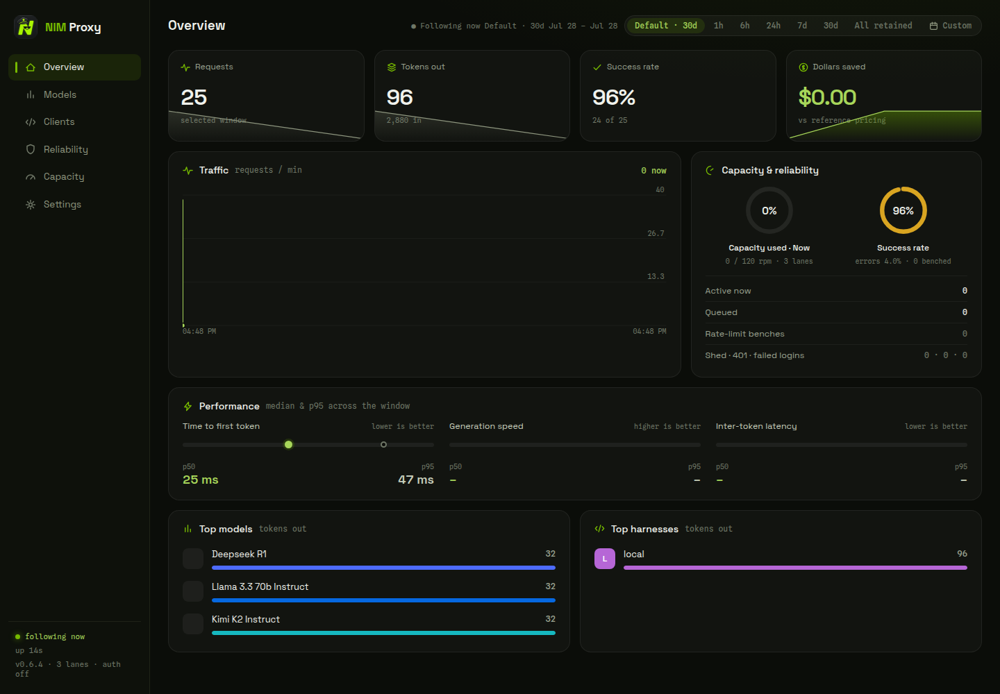

<div align="center">


# flock

**One router for every model you can reach — cloud APIs and local fleets —
with the rate-limit brains to stay inside every provider's speed limit.**

Speaks **OpenAI** (`/v1/chat/completions`) **and Anthropic**
(`/v1/messages` — Claude Code works out of the box).

[](https://github.com/toxicwind/hodos/actions/workflows/ci.yml)
[](https://github.com/toxicwind/hodos/actions/workflows/codeql.yml)
[](LICENSE)
[](https://www.rust-lang.org)
[](#how-it-works)



</div>

---

Free model tiers don't cost money — they cost **patience**. NVIDIA NIM's free
tier is ~40 requests/minute per key; other providers have their own ceilings.
When an agent hits the limit, the upstream answers 429 and most clients simply
abort. flock sits between your agents and every provider and makes the limit
invisible:

```
 Claude Code ──┐                        ┌─► NVIDIA NIM (key pool, paced)
 OpenCode    ──┤   OpenAI   ┌─────────┤─► OpenRouter · Groq · Cerebras · …
 Codex       ──┼────────────►  FLOCK  ├─► local llama-swap herd
 n8n / SDKs  ──┘   Anthropic └─────────┤─► any OpenAI-compatible endpoint
      /v1/messages  /v1/chat/completions
```

Every lane: per-key sliding-window pacing, a global FIFO dispatcher, 429
ride-out with `Retry-After` honored, adaptive per-model worker ceilings,
circuit breakers, Elo health scoring, SSE heartbeats, and a cached
`/v1/models` that costs zero rate budget. Load-tested: 100 concurrent
clients, zero upstream rate violations.

This tool **respects provider terms of service** — it maximizes *your own*
API keys while keeping every key inside its documented speed limit.

---

## Highlights

- **Claude Code, natively** — `POST /v1/messages` and
  `/v1/messages/count_tokens` translate the Anthropic wire protocol
  (content blocks, tool use, streaming event grammar) to any OpenAI-shaped
  upstream. Point `ANTHROPIC_BASE_URL` at flock and go.
- **Multi-provider routing** — 30+ providers from the generated Roost
  catalog (NIM, OpenRouter, Groq, Cerebras, Together, Mistral, Google EAP,
  local herds…), selected by named strategies with Elo health scoring and
  context-aware demotion.
- **Honest catalogs** — `/v1/models` serves only entitlement-verified
  models; the strike machinery quarantines anything that starts failing
  mid-flight instead of advertising a guaranteed 404.
- **Headless-friendly** — every critical setting can be seeded from
  environment variables at boot; the operator dashboard (sessions, roles,
  live metrics, Prometheus at `/metrics`) remains the day-2 surface.
- **Durable state** — SQLite (WAL) routing state, append-only usage history
  with bounded retention, hot config reload, `SIGHUP` re-seeding.

## Quick start

```bash
# build (nightly toolchain; rust-toolchain.toml pins it)
cargo build --release

# seed credentials headlessly — the store persists them for the dashboard
export NIM_API_KEYS="nvapi-key1 nvapi-key2"   # NVIDIA keys (40 RPM each)
export PROXY_API_KEYS="npk_client1"           # keys your clients present
export PORT=8000 DATA_DIR=./data

./target/release/flock
```

Or run the interactive wizard (first visitor claims the superuser):

```bash
PORT=8000 DATA_DIR=./data ./target/release/flock
# open http://localhost:8000 → /setup
```

### Claude Code

```bash
export ANTHROPIC_BASE_URL="http://localhost:8000"
export ANTHROPIC_AUTH_TOKEN="<one of your PROXY_API_KEYS>"

claude   # requests hit /v1/messages → translated → your model fleet
```

`claude-*` model ids map to the strongest verified model by default;
override with `FLOCK_ANTHROPIC_DEFAULT_MODEL` or request any real id
verbatim.

### OpenAI-compatible clients

```bash
curl -s localhost:8000/v1/chat/completions \
  -H "Authorization: Bearer $PROXY_API_KEY" \
  -H "Content-Type: application/json" \
  -d '{"model":"z-ai/glm-5.3-flash","messages":[{"role":"user","content":"hi"}]}'
```

### Kilo / kappa custom provider

```jsonc
{
  "provider": {
    "flock": {
      "name": "Flock (local router)",
      "env": ["FLOCK_CLIENT_KEY"],
      "npm": "@ai-sdk/openai-compatible",
      "options": { "baseURL": "http://127.0.0.1:25193/v1" },
      "models": {
        "nvidia/nemotron-3.5-super-vl-120b-a12b": { "name": "Nemotron 3.5 Super VL" }
      }
    }
  }
}
```

## Configuration

The store (`DATA_DIR/config.json`, edited in the dashboard) is the source of
truth. Environment variables **seed** it at boot — additive and idempotent;
nothing the operator set through the dashboard is ever downgraded.

| Variable | Seeds |
|---|---|
| `NIM_BASE_URL` | upstream base URL (default: NVIDIA NIM) |
| `NIM_API_KEYS` | NIM key pool (comma/space separated) |
| `RPM_PER_KEY` | per-key rpm for environment-seeded keys |
| `PROXY_API_KEYS` | client bearer keys (stored hashed, never plaintext) |
| `ADMIN_PASSWORD` | first superuser — only when no superuser exists |
| `INSECURE_NO_AUTH=1` | switch `/v1` to open mode (explicit opt-in) |
| `MAX_WAIT_SECS`, `HEARTBEAT_SECS`, `MODELS_TTL_SECS`, `STREAM_IDLE_SECS`, `REQUEST_TIMEOUT_SECS`, `MAX_INFLIGHT` | patience + load limits |
| `STRICT_PASSTHROUGH`, `HISTORY_DAYS` | relay + retention |
| `PORT`, `HOST`, `DATA_DIR`, `TRUST_PROXY` | server itself (not stored) |

Secrets are stored hashed (client keys) or in the local store file only —
they never appear in logs, metrics, or responses.

## How it works

1. **Admission** — client auth (keyed or open), in-flight shed, deadline
   header (`x-flock-deadline-ms`).
2. **Dispatch** — global FIFO + per-lane permit; the model-pressure governor
   parks lanes that hit a provider's worker ceiling (adaptive, dissolves on
   pressure clear).
3. **Pacing** — per-key sliding window paced to the provider limit; keys
   rotate round-robin with prefix-cache affinity.
4. **Ride-out** — 429/5xx retried with `Retry-After` honored; circuit
   breakers per provider; empty-completion strikes quarantine dead models.
5. **Observation** — Prometheus metrics, Elo health, structured routing
   decisions (why a provider was chosen, why others were skipped), usage
   history with bounded retention.

## Operations

```bash
curl -s localhost:8000/health          # liveness (always open)
curl -s localhost:8000/metrics         # Prometheus
open http://localhost:8000/            # operator dashboard (sessions/roles)
```

Deployment patterns, scraping, supply-chain posture, and the dashboard API
are documented in [`docs/`](docs/) and the operator knowledge base in
[`knowledge/`](knowledge/).

## Testing

```bash
cargo test            # unit + integration (wire contracts, e2e, openapi)
cargo fmt --check     # nightly rustfmt (rust-toolchain.toml pins the channel)
cargo clippy
```

The suite covers the wire-format contracts (OpenAPI regenerated and asserted
against handlers), SSE translation grammar, key-pool rotation under 429
storms, governor pressure lifecycle, and retention across restarts.

## Provenance

The proxy core derives from [miztertea/nim-proxy](https://github.com/miztertea/nim-proxy)
(MIT) — one canonical build absorbed into the flock tree (v0.6.6, zero feature
loss; see `FEATURE_PARITY.md`). Deliberate compatibility keeps: the
`nimproxy-history` record marker, `X-Nim-Keys-Deadline` header, and
`/api/settings/nim-keys` route.

## Contributing, security & support

See [`CONTRIBUTING.md`](CONTRIBUTING.md), the security policy in
[`SECURITY.md`](SECURITY.md), and support channels in
[`SUPPORT.md`](SUPPORT.md). Patches follow Plan → Act → Verify with red→green
regression checks; every wire-format change needs a decision record and a
release note.

## License

[MIT](LICENSE) — upstream nim-proxy © its authors; flock changes © flock
contributors.
